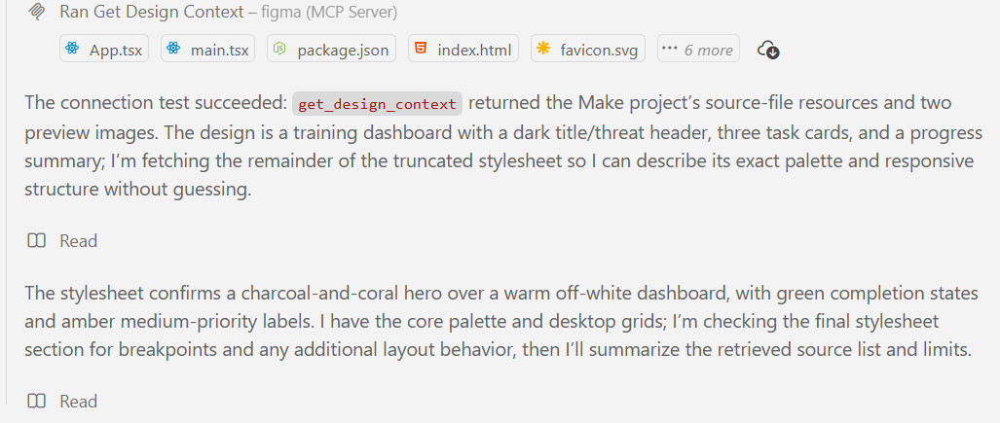

# Mission 06 — MCP Integration

## 1. Objective

The objective of this mission is to connect my AI coding agent to my selected dashboard design using Model Context Protocol (MCP).

My mentor approved using Figma instead of Stitch, so I used the official Figma MCP server to connect my Figma Make design to Visual Studio Code.

## 2. MCP Architecture

MCP (Model Context Protocol) allows AI coding applications to communicate with external tools and retrieve useful context.

The roles in my setup are:

| Role | Tool | Responsibility |
|---|---|---|
| Host | Visual Studio Code with GitHub Copilot | Runs my AI coding workflow |
| Client | MCP client integrated with VS Code/Copilot | Communicates with the MCP server |
| Server | Figma MCP Server | Provides access to supported Figma design context |

Connection flow:

**Figma Make → Figma MCP Server → VS Code / GitHub Copilot**

## 3. Design Project

**Project:** Asta's Preparation Dashboard

**Design tool:** Figma Make

**Project link:**

https://www.figma.com/make/gHApJ5hgzrvpKAsUGJvd2D/Design-Asta-s-Preparation-Dashboard

The design includes desktop and mobile layouts.

## 4. MCP Connection and Tool Call

I configured the Figma MCP server in VS Code and tested the connection using GitHub Copilot Agent.

**Actual tool called:** `get_design_context`

**What I asked the agent to do:**

Access my Asta Preparation Dashboard project through Figma MCP and retrieve the available design information, including its components, structure, styling, and layout.

**Result:** Successful.

The tool retrieved the project's design context and source resources.

## 5. Returned Design Information

The MCP tool returned source files including:

- `src/App.tsx`
- `src/main.tsx`
- `src/index.css`
- `package.json`
- `index.html`
- Additional configuration and asset files

It also returned two design preview images.

The retrieved information described:

- A dark dashboard header and Lucifero threat brief.
- Three training cards: Sword Control, Physical Endurance, and Team Coordination.
- Task priority and completion controls.
- A progress summary with a completed-task counter and progress indicators.
- A responsive layout.

The retrieved design uses charcoal, warm off-white, and coral accents, with Barlow Condensed and Inter typography.

## 6. Limitations Encountered

The MCP session creation request did not support Figma Make files.

However, I successfully accessed the Make project using a direct `get_design_context` call without a session ID.

The available tools also did not provide a general endpoint for listing all Figma projects.

These limitations did not prevent me from retrieving the selected project's design context.

No manual fallback was required.

## 7. Evidence of Successful MCP Connection

The screenshot below shows the successful Figma MCP tool call and the returned design resources.

Screenshot location:

`docs/evidence/figma-mcp-success.png`

No passwords, API keys, or access tokens are included in the screenshot.

## 8. Conclusion

The MCP connection was successfully verified.

GitHub Copilot accessed my Figma Make project through an actual Figma MCP tool call and retrieved useful design information.

This confirms that my coding agent can obtain design context to support the later implementation of the dashboard using Next.js, TypeScript, and Tailwind CSS.

MCP is used in my development workflow. The final dashboard does not require an MCP server or built-in AI chatbot.